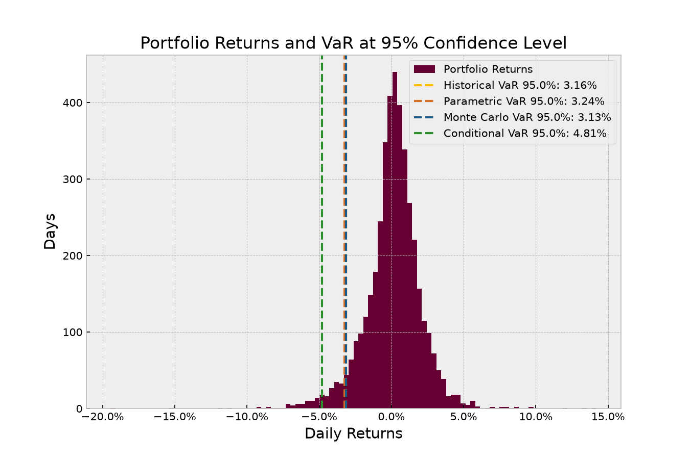
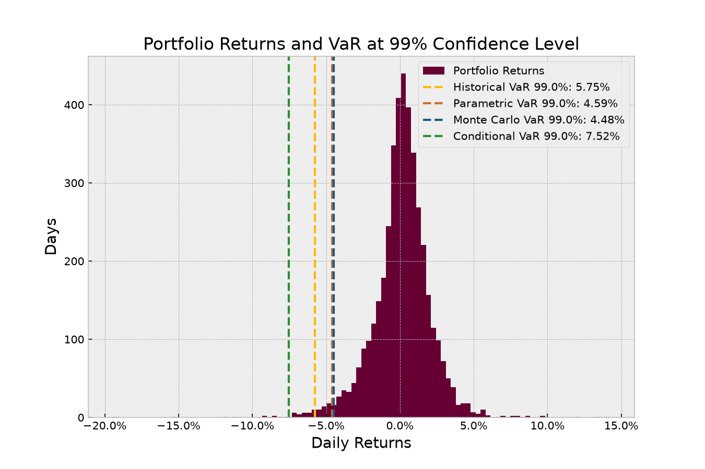

# Portfolio Value at Risk (VaR)
Python script for calculating daily **Value at Risk (VaR)** and **Conditional VaR (Expected Shortfall)** on a 30-stock tech/AI portfolio using historical data from Yahoo Finance (2010–present)

## What's inside
- `main.py` – loads portfolio weights from `portfolio.csv`, fetches prices via `yfinance`, handles missing pre-IPO data, runs the models, and prints backtest results
- `methods.py` – implementations of:
  - **Historical VaR** (percentile of actual log-returns)
  - **Parametric VaR** (variance-covariance using normal distribution)
  - **Monte Carlo VaR** (100,000 simulations from multivariate normal distribution)
  - **Conditional VaR / CVaR** (average loss beyond the VaR threshold)
  - **Backtesting** (counts how many days actual losses exceeded the VaR estimate)
- `plots.py` – histogram of daily returns with VaR/CVaR levels
- `portfolio.csv` – 30 tickers and their portfolio weights

### Handling recent IPOs
Some stocks in the portfolio went public after 2010 (`PLTR`, `ARM`, `SNOW`, `CEG`, `NBIS`). Instead of dropping everything before their IPO date, missing pre-IPO returns are backfilled using `SPY` daily returns scaled by each stock's volatility relative to `SPY`

